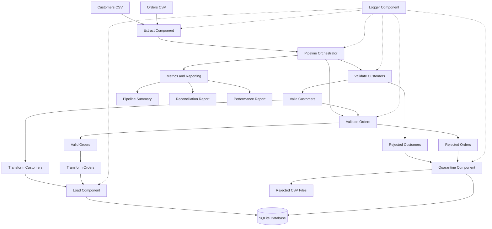

# ETL Framework Architecture

## 1. Overview

The Reusable Data Engineering ETL Framework follows a modular Extract, Transform, and Load (ETL) architecture.

It processes two related datasets, Customers and Orders, using reusable Python components. The framework extracts source data from CSV files, validates records against schema and business rules, separates valid and rejected records, transforms valid data, and loads the results into a local SQLite database.

The framework also includes reusable components for logging, operational metrics, rejected record quarantine, reconciliation, and reporting.

The architecture is designed to support reproducibility, traceability, safe reruns, and maintainability.

## 2. High-Level Architecture

The following diagram illustrates the overall data flow and the interaction between the reusable ETL components.



## 3. Main Architecture Components

The framework consists of the following reusable components:

| Component | File | Responsibility |
|---|---|---|
| Configuration | config.py | Centralizes project paths and dataset configuration |
| Extraction | extract.py | Reads CSV files and adds source metadata |
| Validation | validate.py | Checks schemas and business rules |
| Transformation | transform.py | Cleans and standardizes valid records |
| Loading | load.py | Loads transformed records into SQLite |
| Quarantine | quarantine.py | Stores rejected records with traceability |
| Logging | logger.py | Records pipeline activities and errors |
| Metrics | metrics.py | Tracks execution metrics and pipeline status |
| Reporting | reporting.py | Generates pipeline and reconciliation reports |
| Orchestration | pipeline.py | Coordinates the complete ETL workflow |

## 4. ETL Processing Workflow

### Step 1: Data Extraction

The extraction component reads input CSV files from:

`data/raw/`

Input files:

- `customers.csv`
- `orders.csv`

The extraction component uses pandas to read the records.

It also adds source metadata:

- `source_file`: Original source filename.
- `source_row_number`: Original CSV row number.

This metadata helps trace processed and rejected records back to their original source.

The extraction component handles missing files, empty files, and malformed CSV input.

**Implementation:** `src/etl_framework/extract.py`

### Step 2: Customer Validation

The customer validation component checks the extracted customer records against the defined schema and business rules.

Customer validation includes:

- Customer ID must be present.
- Customer IDs must be unique.
- Customer name must be present.
- Email must have a valid format.
- Registration date must be valid.
- Optional city values can be NULL.

Records are separated into valid and rejected customer records.

**Implementation:** `src/etl_framework/validate.py`

### Step 3: Order Validation

The order validation component checks order records against the defined schema and business rules.

Order validation includes:

- Order ID must be present and unique.
- Customer ID must reference a valid customer from the current processing batch.
- Order amount must be numeric and greater than zero.
- Order date must be valid.
- Order status must belong to the supported status values.

Supported order statuses:

- Pending
- Cancelled
- Shipped
- Delivered

Orders referencing invalid or unavailable customers are rejected.

**Implementation:** `src/etl_framework/validate.py`

### Step 4: Rejected Record Quarantine

Invalid records are not silently discarded.

The quarantine component stores rejected records in:

- SQLite table: `rejected_records`
- Customer rejection export: `data/rejected/rejected_customers.csv`
- Order rejection export: `data/rejected/rejected_orders.csv`

Each rejected record retains:

- Pipeline run ID.
- Dataset name.
- Original source filename.
- Original source row number.
- Rejection reason.
- Original record stored as JSON.
- Quarantine timestamp.

The SQLite quarantine table uses `dataset_name` to identify the source dataset.

A uniqueness constraint prevents duplicate quarantine entries for the same run and rejected record.

**Implementation:** `src/etl_framework/quarantine.py`

### Step 5: Data Transformation

Valid records are cleaned and standardized before loading.

Customer transformations include:

- Removing unnecessary whitespace.
- Converting email addresses to lowercase.
- Converting empty city values to NULL.
- Standardizing registration dates to `YYYY-MM-DD`.

Order transformations include:

- Removing unnecessary whitespace.
- Converting amounts into numeric values.
- Rounding amounts to two decimal places.
- Standardizing order status values.
- Standardizing order dates to `YYYY-MM-DD`.
- Deriving `order_year` and `order_month`.

The transformation component uses pandas operations to process the datasets.

**Implementation:** `src/etl_framework/transform.py`

### Step 6: Data Loading

Transformed customer and order records are loaded into the SQLite database.

The loading component:

- Creates target tables when required.
- Uses primary keys to identify records.
- Uses UPSERT operations to insert new records and update existing records.
- Prevents unintended duplicate records during repeated pipeline executions.
- Validates primary-key integrity before loading.

Target tables:

- `customers`
- `orders`

Database location:

`data/processed/etl_database.db`

**Implementation:** `src/etl_framework/load.py`

### Step 7: Logging and Monitoring

The logging component records pipeline execution activities, successful operations, warnings, and errors.

The metrics component tracks:

- Unique pipeline run ID.
- Pipeline start and end timestamps.
- Input record counts.
- Valid record counts.
- Rejected record counts.
- Loaded record counts.
- Execution duration.
- Pipeline execution status.
- Failure details.

**Implementations:**

- `src/etl_framework/logger.py`
- `src/etl_framework/metrics.py`

### Step 8: Reporting and Reconciliation

After pipeline execution, the reporting component generates operational reports.

The generated reports include:

- `reports/pipeline_summary.json`
- `reports/reconciliation_report.csv`
- `reports/performance_report.md`

The reconciliation process checks that all input records are accounted for.

The reconciliation rule is:

`Input Records = Valid Records + Rejected Records`

Loaded record counts are also tracked to verify the loading operation.

**Implementation:** `src/etl_framework/reporting.py`

## 5. Data Model and Relationships

The framework processes two related entities.

### Customers

- Primary key: `customer_id`
- Grain: One record per customer.
- Stores customer profile and registration information.

### Orders

- Primary key: `order_id`
- Logical foreign key: `customer_id`
- Grain: One record per order.
- Stores order date, amount, and status.

### Entity Relationship

One customer can have multiple orders, while each accepted order must reference one valid customer.

Relationship:

`customers.customer_id → orders.customer_id`

The framework enforces this relationship through validation before order records are accepted.

This is a logical referential-integrity check performed by the validation component. A physical SQLite foreign-key constraint is not implemented.

## 6. Storage Design

| Storage Location | Purpose |
|---|---|
| `data/raw/` | Original customer and order CSV files |
| `data/rejected/` | Rejected record CSV exports |
| `data/processed/` | Processed SQLite database |
| SQLite `customers` | Valid customer records |
| SQLite `orders` | Valid order records |
| SQLite `rejected_records` | Quarantined record history |
| `logs/` | Pipeline execution logs |
| `reports/` | Pipeline summary and operational reports |

## 7. Idempotency and Recovery

The SQLite loading component uses primary-key-based UPSERT operations.

When the same input files are processed again:

- Existing records are updated instead of creating duplicate records.
- New records are inserted.
- Primary-key uniqueness is maintained.

Rejected records are associated with unique pipeline run IDs. A uniqueness constraint prevents duplicate quarantine entries within the same run.

### Failure and Retry Handling

The pipeline records failure status and error details when an exception occurs.

If a dataset fails after another dataset has already loaded successfully, the pipeline can be rerun using the same source files.

UPSERT operations allow already-loaded records to be processed again without creating unintended duplicates.

The retry and partial-failure recovery behavior is covered through automated tests.

### Recovery Limitations

- A single atomic transaction across both datasets is not implemented.
- Automatic deletion of target records removed from source files is not supported.
- Separate historical versions of updated customer and order records are not maintained.

## 8. Configuration Management

Project paths and dataset configuration are centralized in:

`src/etl_framework/config.py`

The configuration module defines:

- Project root directory.
- Raw data directory.
- Processed data directory.
- Rejected data directory.
- Database path.
- Log directory.
- Report directory.
- Input file paths.

Centralized configuration keeps file paths separate from the ETL processing logic.

## 9. Error Handling

The framework handles common data and pipeline errors.

Examples include:

- Missing source files.
- Empty source files.
- Malformed CSV input.
- Missing required columns.
- Invalid customer and order records.
- Duplicate identifiers.
- Invalid customer references.
- Database loading failures.

Invalid data records are quarantined with rejection reasons, while pipeline-level failures are logged and reported.

## 10. Technology Stack

| Technology | Purpose |
|---|---|
| Python | ETL implementation |
| pandas | CSV extraction and tabular data processing |
| SQLite | Local target database |
| pytest | Automated testing |
| Python Logging | Pipeline activity and error logging |
| UUID | Unique pipeline execution identifiers |

## 11. Execution Entry Point

The complete ETL workflow is started through:

```bash
python run_pipeline.py
```

The execution entry point invokes the pipeline orchestrator, which coordinates extraction, validation, quarantine, transformation, loading, metrics, logging, and reporting.

## 12. Scalability and Extensibility

The framework uses separate reusable components so that individual ETL operations can be maintained and extended independently.

Potential future extensions include:

- Additional datasets.
- Additional input file formats.
- API-based data extraction.
- Configurable schema definitions.
- Incremental data processing.
- Cloud-based storage and orchestration.
- Distributed processing for larger workloads.

The current implementation is locally executable and uses pandas and SQLite. Distributed processing and production-scale cloud deployment are outside the current implementation scope.

## 13. Conclusion

The architecture demonstrates a modular and reusable ETL framework with separate components for extraction, validation, transformation, loading, quarantine, logging, metrics, and reporting.

It supports two related datasets, maintains record-level traceability, handles invalid records, supports idempotent loading, and provides automated tests and operational reports.

The design provides a foundation for extending the framework to additional datasets and larger data engineering workloads.